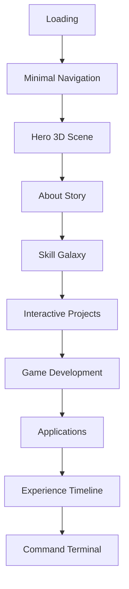

# Wireframes

## Home Flow

## Desktop

### Hero

- Full viewport.
- Massive name and title lockup on the left.
- Interactive 3D glass core on the right.
- Live availability pill, two CTAs, and technical capability strip.
- Animated ambient shader layer behind all content.

### About

- Editorial lead copy.
- Floating timeline fragments.
- Three capability panes: systems, interfaces, worlds.

### Skills

- No bars.
- Central statement surrounded by interactive technology clusters.
- Hovering a cluster reveals tools and production context.

### Projects

- Pinned horizontal scroll.
- Each project gets a large mockup, metrics, architecture notes, and actions.
- Cards are avoided; each project behaves like a mini case-study hero.

### Games

- Cinematic reel with gameplay slots.
- Engine badges for Unity, Unreal, and Godot.
- Demo/trailer placeholders.

### Applications

- Device mockup switcher for desktop, mobile, and cross-platform apps.
- Tab transitions with live-preview styling.

### Contact

- Full-width terminal.
- Commands reveal contact details, resume, projects, and social links.

## Tablet

- Hero becomes stacked but keeps the 3D scene above the fold.
- Pinned sections reduce duration.
- Project showcases remain horizontal where screen width allows.
- Terminal remains fully interactive.

## Mobile

- Cursor is disabled.
- WebGL scene becomes lighter and can collapse behind content.
- Scroll-triggered animations become simple reveals.
- Project and skill experiences become swipe-friendly vertical stacks.
- Terminal command chips appear above the input for easier discovery.
